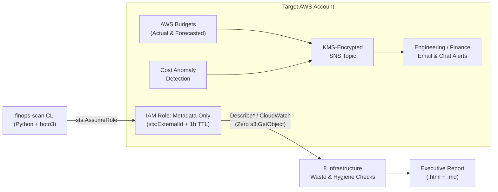

# `aws-finops-guardrails` — AWS Cost Audit, Waste Scanner & Budget Guardrails

> **Prevent surprise AWS bills on Day 1, and uncover wasted monthly cloud spend in 60 seconds — without ever granting access to customer S3 objects, secrets, or database rows.**

Built and maintained by **[Rahul Nadagoud](https://rahulnadagoud.com)** ([LinkedIn](https://www.linkedin.com/in/rahul-nadagoud/) · [GitHub](https://github.com/rnadagoud)).

---

## Why This Exists

Small engineering teams and growing startups lose 20–40% of their monthly AWS bill to quiet infrastructure drift: forgotten `gp2` volumes, unattached post-migration disks, idle staging `Multi-AZ` RDS instances, redundant non-prod NAT Gateways, and zero budget anomaly alerts.

At the same time, security-conscious CTOs rightly hesitate to hand external auditors `arn:aws:iam::aws:policy/ReadOnlyAccess` — because AWS's managed `ReadOnlyAccess` policy permits `s3:GetObject`!

`aws-finops-guardrails` solves both sides in one clean kit:
1. **Preventive Terraform Module (`terraform/`):** Deploys KMS-encrypted SNS notifications, multi-threshold Monthly AWS Budgets (actual + forecasted), immediate AWS Cost Anomaly Detection, and a **strictly scoped 19-action metadata-only IAM Audit Role** protected by `sts:ExternalId` (see [ADR-001](docs/adr/001-least-privilege-metadata-only-audit-role.md)).
2. **Read-Only Python Waste Scanner (`src/finops_scanner/`):** Audits an account across regions for the **8 highest-frequency startup AWS leaks** and generates a client-ready **Markdown + standalone HTML Executive Audit Report** with annualized dollar savings and copy-paste AWS CLI remediation commands.

---

## Architecture



---

## The 8 Automated Checks

| ID | Check | What It Catches | Pricing Signal |
| :--- | :--- | :--- | :--- |
| `EBS-001` | **Unattached EBS Volumes** | Orphaned `available` disks left after EC2 termination/migrations | 100% storage cost saved |
| `EBS-002` | **GP2 → GP3 Online Upgrade** | Legacy `gp2` disks upgradable with zero downtime to `gp3` | ~20% cheaper + 3,000 free IOPS |
| `EBS-003` | **Aging EBS Snapshots** | Manual snapshots older than 90 days lacking DLM lifecycle rules | `$0.05/GB-month` |
| `NET-001` | **Unassociated Elastic IPs** | Idle public IPv4 addresses not attached to an ENI | `$3.65/mo` (`$0.005/hr`) each |
| `CMP-001` | **Idle / Oversized EC2** | Running instances with <5% 14-day avg CloudWatch CPU | Right-size / Graviton / stop schedule |
| `RDS-001` | **Idle / Multi-AZ Staging RDS** | Available RDS instances with <5% CPU & near-zero DB connections | 45–90% savings |
| `S3-001` | **S3 Lifecycle & Public Block** | Buckets missing Lifecycle rules or incomplete `PublicAccessBlock` | Storage hygiene + security win |
| `ELB-001` & `NET-002` | **Idle ALB/NLB & NAT Gateways** | Load balancers with 0 targets/traffic & low-traffic NAT Gateways | `$16.43/mo` (ALB) / `$32.85/mo` (NAT) |

---

## Quickstart

### 1. Try the Instant Demo Report (Zero AWS Credentials Needed)
```bash
python3 -m venv .venv && source .venv/bin/activate
pip install -e ".[dev]"

# Generate sample executive reports in ./reports/
finops-scan --demo --output-dir reports
firefox reports/executive-audit-report.html
```

### 2. Deploy the $5 / $15 / $30 Sandbox Guardrail in Terraform
```bash
cd examples/sandbox-5-15-30
terraform init
terraform apply \
  -var="alert_email=you@example.com" \
  -var="audit_external_id=$(openssl rand -hex 16)"
```

### 3. Run a Live Read-Only Scan Against an AWS Account
```bash
# Using ambient AWS CLI profile:
finops-scan --regions ap-south-1 us-east-1 --output-dir reports

# Or assuming the cross-account metadata-only IAM role:
finops-scan \
  --regions ap-south-1 us-east-1 \
  --role-arn arn:aws:iam::123456789012:role/sandbox-finops-readonly-auditor \
  --external-id "your-unique-external-id" \
  --output-dir reports
```

### 4. Run Tests
```bash
pytest -v
# or with Python stdlib unittest:
PYTHONPATH=src python3 -m unittest discover -s tests -v
```

---

## Cost to Run
- **Scanner CLI:** `$0.00` (uses standard `Describe*` and minimal CloudWatch `GetMetricStatistics` calls within free tier).
- **Terraform Guardrails:** ~$1.00/month for the customer-managed KMS key (AWS Budgets up to 2 action-free budgets and Cost Anomaly Detection monitors are free; SNS email notifications within free tier). Always `terraform destroy` temporary lab stacks when finished testing.

---

## License
MIT — Built by [Rahul Nadagoud](https://rahulnadagoud.com).
